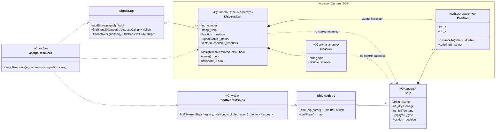
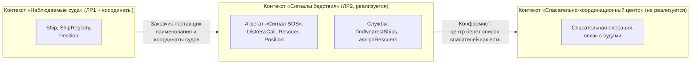

<div align="center">
Министерство науки и высшего образования Российской Федерации <br />
Федеральное государственное бюджетное образовательное учреждение <br />
высшего образования <br />
«Московский государственный технический университет имени Н.Э. Баумана <br />
(национальный исследовательский университет)» <br />
(МГТУ им. Н.Э. Баумана)
</div>
<hr />
<div align="center">
ФАКУЛЬТЕТ «ИНФОРМАТИКА И СИСТЕМЫ УПРАВЛЕНИЯ» <br />
КАФЕДРА «КОМПЬЮТЕРНЫЕ СИСТЕМЫ И СЕТИ» (ИУ6)
</div>
<br />
<div align="center">
ОТЧЁТ <br />
к лабораторной работе №2 <br />
по дисциплине «Современные средства разработки программного обеспечения» <br />
<b>«Изменение в предметной области»</b>
</div>
<br />

Преподаватель: Фетисов М.В.


Студент группы ИУ6-73Б: Архипов А.В.

## Задание

За основу взята программа из ЛР1 (задача «Наблюдаемые суда», карточка «судно»).
Усложнение задания взято из таблицы 7, вариант №1 («Наблюдаемые суда» / «Морское судно»):

> Необходимо определить три морских судна, находящихся на минимальном прямом расстоянии
> от другого судна, которое терпит бедствие и посылает сигналы SOS.

## Анализ изменений в модели

Чтобы найти ближайшие суда, в модель нужно добавить новые понятия:
- **координаты судна** — где судно находится сейчас (в ЛР1 этого не было);
- **сигнал SOS** — номер, судно, которое терпит бедствие, место бедствия, состояние;
- **место бедствия** — координаты судна в момент подачи сигнала;
- **спасатель** — судно, назначенное на помощь, и расстояние до места бедствия;
- **состояние сигнала** — принят → спасатели назначены → завершён;
- **поиск ближайших судов** — три судна с минимальным прямым расстоянием до места бедствия.

Принятые уточнения:
- район наблюдения небольшой, поэтому карта считается плоской: координаты `x` (восток) и `y` (север)
  задаются целыми числами в морских милях, прямое расстояние — длина отрезка
  `√((x₁−x₂)² + (y₁−y₂)²)`;
- на помощь не посылаются само терпящее бедствие судно, суда без известных координат и суда,
  которые сами подали незакрытый сигнал SOS;
- при равном расстоянии суда упорядочиваются по наименованию;
- если подходящих судов меньше трёх, назначаются все найденные и выводится предупреждение;
- суда движутся, поэтому команду поиска можно повторить — список спасателей пересчитывается.

### Сущности, объекты-значения, службы, агрегат

| Элемент модели | Вид | Почему |
|---|---|---|
| `DistressCall` (сигнал SOS) | **сущность, корень агрегата** | у сигнала есть номер, по которому его отличают от других; сигнал меняет состояние |
| `Rescuer` (спасатель) | объект-значение | важно только «какое судно и на каком расстоянии», своего номера нет |
| `Position` (координаты) | объект-значение | своего номера нет: две точки с одинаковыми `x` и `y` — одна и та же точка |
| `Ship` (судно) | сущность | отличается от других наименованием (из ЛР1) |
| `findNearestShips` (поиск ближайших судов) | **служба** | перебирает все суда и сравнивает расстояния, своих данных не хранит |
| `assignRescuers` (назначение спасателей) | **служба** | операция затрагивает сразу сигнал, список судов и журнал сигналов, ни одному из них не принадлежит |

**Агрегат «Сигнал SOS»:** `DistressCall` (корень) + `Position` (место бедствия) + `Rescuer`.
- Место бедствия и список спасателей хранятся внутри сигнала и меняются только через методы
  `DistressCall` (`assignRescuers`, `close`).
- Корень проверяет правила агрегата (`DistressCall::invariant`): спасателей не больше трёх,
  среди них нет самого терпящего бедствие судна и нет повторов, закрытый сигнал менять нельзя.
- Сигнал и спасатели ссылаются на суда только по наименованию, сами объекты `Ship` в сигнал не копируются.
- Место бедствия — копия координат судна на момент сигнала, поэтому сигнал не зависит от того,
  что потом происходит с карточкой судна.

### Диаграмма модели



### Ограниченные контексты

В модели две сущности: судно и сигнал SOS. Судно со списком наблюдаемых судов осталось в контексте
«Наблюдаемые суда» из ЛР1 (в него добавлены только координаты), в этой работе реализуется контекст
«Сигналы бедствия». Сама спасательная операция вынесена в отдельный контекст и в программе не реализуется.



- **«Наблюдаемые суда» → «Сигналы бедствия»: заказчик-поставщик.** Сигналам нужны наименования
  и координаты судов. Список судов (поставщик) даёт методы `findShip` и `getShips`,
  контекст сигналов (заказчик) ими пользуется.
- **«Сигналы бедствия» → «Спасательно-координационный центр»: конформист.** Центр принимает
  список назначенных спасателей в том виде, в каком мы его составляем, своей модели сигналов у него нет.

## Рефакторинг

1. Добавлен объект-значение `Position`. В `Ship` добавлены необязательные координаты
   (`hasPosition`, `getPosition`) и второй конструктор. Судно из ЛР1 без координат создаётся так же, как раньше.
2. В `ShipRegistry` методы `hasShip` и `getShip` заменены одним `findShip`, который возвращает
   указатель или `nullptr` (так не нужно дважды искать судно в `map`).
3. Формат файла дополнен необязательными координатами: `<имя> <сухой> <полный> <тип> [<x> <y>]`.
   Файлы из ЛР1 по-прежнему загружаются.
4. В `l3_DomainLayer` добавлены классы сигналов SOS и две службы.
5. `Application` получает в конструкторе ещё и журнал сигналов `SignalLog`. Добавлены новые команды,
   старые команды не изменились (`view` дописывает координаты, только если они известны).
6. Регрессионные тесты ЛР1 (`01`–`06`) прошли без изменений.
7. Добавлены тесты новой функциональности (`07`–`09`).

## Новые команды

```
move <наименование> <x> <y>      - задать координаты судна (морские мили)
sos <номер сигнала> <судно>      - судно терпит бедствие, принять сигнал SOS
nearest <номер сигнала>          - найти три ближайших судна и назначить их на помощь
close <номер сигнала>            - спасение завершено
signals                          - показать все сигналы SOS
```

Пример (`test/08_sos.test`). Volga терпит бедствие в точке (0; 0), рядом Neva (3; 4), Ob (6; 8),
Baltica (0; −7), Lena (10; 0), Don (100; 100), координаты Amur неизвестны:

```
sos 1 Volga
Принят сигнал SOS №1 от судна 'Volga' в точке (0; 0)
nearest 1
Сигнал SOS №1: судно 'Volga' в точке (0; 0)
Ближайшие суда:
1) Neva - 5.0 миль
2) Baltica - 7.0 миль
3) Lena - 10.0 миль
```

Lena и Ob находятся на одинаковом расстоянии 10 миль, выбрана Lena (по алфавиту). Don слишком далеко,
Amur не рассматривается, потому что его координаты неизвестны.
Если затем Neva сама подаст сигнал SOS, то при повторном поиске для Volga её место займёт Ob:

```
sos 2 Neva
...
nearest 1
Сигнал SOS №1: судно 'Volga' в точке (0; 0)
Ближайшие суда:
1) Baltica - 7.0 миль
2) Lena - 10.0 миль
3) Ob - 10.0 миль
```

## Сборка, тесты, CI

```bash
./configure
make
test/run-tests
```

| Тест | Что проверяет |
|---|---|
| `01`–`06` | регрессионные тесты из ЛР1 |
| `07_positions` | координаты: `move`, вывод в `view`, `update` их сохраняет, сохранение и загрузка, файлы с ошибками в координатах |
| `08_sos` | основной сценарий: три ближайших судна, равные расстояния, исключение судов без координат и терпящих бедствие, пересчёт после перемещения, закрытие сигнала |
| `09_sos_errors` | ошибки: неверные аргументы, нет судна или сигнала, нет координат, повторный сигнал, нет спасателей, найдено меньше трёх судов, закрытие без спасателей и повторное |

Сценарий CI: сборка → тесты → документация и отчёт о покрытии. Покрытие кода тестами — более 95 %.

## Выводы

1. Проанализированы изменения модели: выделены сущности, объекты-значения, службы и агрегат
   «Сигнал SOS» с корнем `DistressCall`.
2. Модель разделена на ограниченные контексты, отношения между ними — «заказчик-поставщик» и «конформист».
3. Благодаря изоляции предметной области из ЛР1 изменения затронули в основном уровень DL.
   В класс судна добавлены только координаты, старые команды не изменились, регрессионные тесты прошли.
4. Реализован поиск трёх ближайших к терпящему бедствие судну судов. Сценарий CI выполняется успешно,
   покрытие тестами не меньше 95 %.
